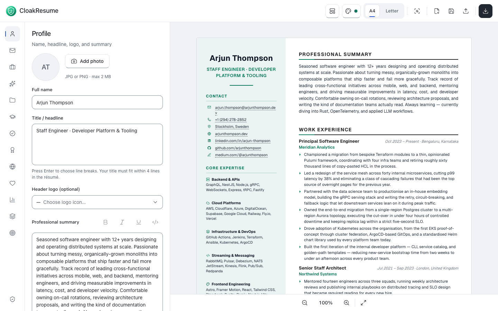

<div align="center">

  <p><strong>Your next chapter. In your words.</strong></p>
  <p>Build, tailor, review and export your résumé in your browser.</p>

  <p><a href="https://resume.cloakyard.com/">resume.cloakyard.com</a></p>

  <p>
    <a href="https://opensource.org/licenses/MIT"></a>
    
    
  </p>

</div>

<p align="center">
  <picture>
    <source media="(prefers-color-scheme: dark)" srcset="public/screenshots/editor-wide-dark.png" />
    
  </picture>
</p>

---

## What it does

CloakResume is a browser-native editor for the complete résumé workflow:

- **Build** — edit profile, contact, experience, education, projects, skills, certifications, awards, languages, interests, tools, stats, extras, and custom sections.
- **Tailor** — keep a target job description beside the draft, review structure and keyword coverage, and run local writing checks with Harper.
- **Design** — choose from 17 live résumé layouts, set the template colour, reorder sections, and preview A4 or US Letter pages.
- **Carry** — export PDF, save or load editable JSON, start with realistic sample content, and return to a browser-saved local draft.

The application follows [Cloakyard Air](DESIGN.md): quiet neutral surfaces,
readable system typography, shared controls and a green landing light drawn from
CloakResume’s mark. Public hyperlinks stay neutral, including hover, with angled
cues where appropriate. Résumé templates preserve their individual typography,
author-selected colours and pagination in both application themes.

## Portable files

**Save** writes a versioned `.cloakresume.json` file containing the résumé, selected
template, document colour, paper size, and optional job description. **Load** checks
the CloakResume discriminator, normalises older or partial résumé data including nested rows, and
restores that workbench state. The JSON workflow was verified with a real browser
save→load round trip.

**Export PDF** renders the selected A4 or US Letter document locally. Exported pages
retain the template's visual layout while adding selectable text and link annotations.
Export reports content outside a page or column instead of silently cropping it.
The profile title supports manual line breaks and displays at most four lines in every
template. The editor flags titles that exceed that space, and PDF export asks you to
shorten them before continuing. The complete title remains in saved drafts.
Body fields support bold, italic, underline, and code through their formatting toolbar.
Use ⌘/Ctrl+B, I, or U for the corresponding keyboard shortcuts. Underline is saved as
`<u>text</u>` and rendered consistently in every template and PDF, with markup excluded
from ATS and writing analysis.
Ordinary prose keeps natural word boundaries; emergency wrapping is reserved for
unbroken values such as URLs. The final A4 sample export was visually inspected across
all five pages and checked with independent PDF text and link extraction tools.

## Privacy and offline behavior

Résumé and job-description content is processed in the browser. The app has no résumé
upload endpoint, required account, analytics, or tracking integration. Drafts use
`localStorage`; JSON and PDF files are read or written directly on the user's device.

The browser still downloads static application assets from the site. A Content
Security Policy limits connections and executable resources to the application
origin. The installable PWA caches the application shell after it has loaded. Harper's
language engine is fetched on the first writing review and cached for later use,
subject to the browser's storage and eviction policies. A cold first visit therefore
still requires a network connection.

See [SECURITY.md](SECURITY.md) for the security boundary and disclosure guidance.

## Technology

| Area              | Technology                                                                                                    |
| ----------------- | ------------------------------------------------------------------------------------------------------------- |
| Application       | [React 19](https://react.dev/) + [TypeScript 7](https://www.typescriptlang.org/)                              |
| Styling           | [Tailwind CSS 4](https://tailwindcss.com/) + app-wide design tokens                                           |
| Build and tooling | [Vite+ (`vp`)](https://viteplus.dev/)                                                                         |
| Writing review    | [Harper](https://writewithharper.com/) WebAssembly in a dedicated worker                                      |
| PDF export        | [html2canvas-pro](https://github.com/yorickshan/html2canvas-pro) + [jsPDF](https://github.com/parallax/jsPDF) |
| PWA               | [vite-plugin-pwa](https://vite-pwa-org.netlify.app/) + Workbox                                                |

## Getting started

Requires Node.js 24 or newer and the Vite+ CLI.

```bash
npm install --global vite-plus
git clone https://github.com/cloakyard/cloakresume.git
cd cloakresume
vp install
vp dev
```

| Command                       | Purpose                                                       |
| ----------------------------- | ------------------------------------------------------------- |
| `vp install`                  | Install the locked dependency graph                           |
| `vp dev`                      | Start the development server                                  |
| `vp check`                    | Format, lint, and type-check with TypeScript 7                |
| `vp test`                     | Run the test suite                                            |
| `vp build`                    | Create the production bundle                                  |
| `vp preview`                  | Preview a production build                                    |
| `vp outdated`                 | Report packages with newer releases                           |
| `vp pm audit`                 | Audit the installed dependency graph                          |
| `vp run generate-icons`       | Regenerate favicon and install icons from the app-icon source |
| `vp run generate-og`          | Render the Air social card using the real editor capture      |
| `vp run generate-screenshots` | Capture production landing/editor images in light and dark    |

The browser regression tests cover long-field editing, current-job dates, autosave recovery, imports, photo uploads, writing-engine retries, and page clipping. They use Google Chrome on macOS by default; set `CHROME_PATH` to a Chrome or Chromium executable elsewhere. A missing browser is a blocked validation gate, even if an individual suite reports a skip. After `vp run build`, run the complete production suite with `CLOAKRESUME_BROWSER_BUILD=production vp test run --no-file-parallelism`; acceptance requires zero skipped tests.

Vitest is pinned to the version bundled by Vite+. Upgrade that pin together with Vite+ rather than independently. The PWA asset generator runs through `vp run generate-icons`; the Vite plugin's optional asset-generation integration is disabled.

## Project map

```text
cloakresume/
├── artwork/og.html            # Air social composition using the real editor capture
├── public/
│   ├── cloakresume-mark.svg  # Canonical 64px product mark and favicon source
│   ├── icons/                 # Favicons, install icons, and Open Graph image
│   └── screenshots/           # Narrow and wide PWA/README captures
├── src/
│   ├── components/            # Landing, editor chrome, controls, overlays, and review UI
│   │   ├── ats/               # ATS and writing-review panes
│   │   └── editor/            # Editors for every résumé section
│   ├── data/                  # Blank and realistic sample résumé generators
│   ├── templates/             # 17 output layouts and shared pagination helpers
│   ├── utils/                 # ATS, grammar, export, colour, storage, and rich-text logic
│   ├── App.tsx                # State and workflow composition
│   ├── cloak-family.css       # Remaining compatibility adapters; see cleanup record
│   └── index.css              # Base styles and Tailwind theme bridge
├── DESIGN.md                  # Authoritative layout and interaction contract
├── tokens.css                 # Legacy/output bridge; pinned Air CSS owns application UI
├── docs/
│   ├── brand-assets.md        # Social/PWA asset source and regeneration workflow
│   └── design-audit.md        # Full app and component coverage audit
├── index.html                 # Metadata and CSP
├── vite.config.ts             # Vite+, PWA manifest, and Workbox configuration
└── package.json
```

## Design and asset references

- [DESIGN.md](DESIGN.md) defines the complete portable Air contract and CloakResume requirements. [src/styles/air.css](src/styles/air.css) is the pinned family stylesheet.
- [docs/air/surfaces.json](docs/air/surfaces.json), [validation](docs/air/validation.md) and [cleanup record](docs/air/code-cleanup.md) track current migration coverage and remaining acceptance gates. [docs/design-audit.md](docs/design-audit.md) preserves the historical Workbench audit.
- [tokens.css](tokens.css) retains live compatibility/output values; the pinned Air bundle owns application design.
- [docs/logic-audit-2026-09-14.md](docs/logic-audit-2026-09-14.md) records the reliability audit, resolved bugs, verification, and remaining improvements.
- [docs/brand-assets.md](docs/brand-assets.md) records canonical OG, PWA screenshot, favicon, and launcher-asset dimensions plus the capture states used to generate them.
- [src/templates/TEMPLATE_INSTRUCTIONS.md](src/templates/TEMPLATE_INSTRUCTIONS.md) is the contract for résumé template coverage, pagination, accessibility, and ATS-safe output.

## Contributing and license

Contributions are welcome. Read [CONTRIBUTING.md](CONTRIBUTING.md) before changing
application chrome or résumé templates. CloakResume is licensed under the
[MIT License](LICENSE).

<p align="center">
  Built with care by <a href="https://github.com/sumitsahoo">Sumit Sahoo</a>
</p>
