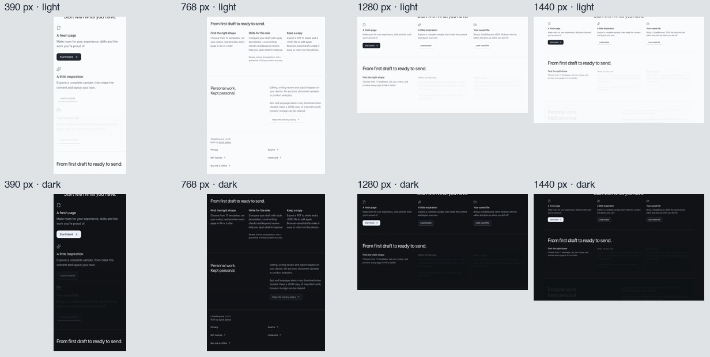

# CloakResume landing motion and web dependencies

24 November 2026 · Air 1.8.1

Three start options, three feature articles and the privacy summary.

The production landing passed 22 viewport sizes in both themes in Chromium and
WebKit. The browser measured the combined 520 ms wipe, fade and 4 px settle,
checked the stagger where blocks enter together, and scrolled back through the
page to check that blocks play once. Focus, initial fragments, return from
privacy, live reduced motion, print, forced colours and the missing-observer
fallback passed. A touch profile also checked direct navigation with reduced motion.

## Dependencies and feature coverage

Compared all 23 direct web runtime and development package declarations with
the npm registry and refreshed the lockfile. Vite+ 1.8.0, Lucide React 1.78.0 and Puppeteer Core 25.18.1. The toolchain test checks the current pnpm, Vite+ and Vite-compatible core pins.

Frozen pnpm installation, build, type/lint/format checks, Knip and package audit. The full production suite passed 373 tests in 10 files with zero skips, including editor and template layout regressions. Entry checks covered 335 layouts and 14 journeys.

This review covered the web landing and the listed regression checks on local
builds. Physical-device and assistive-technology acceptance remain open.
